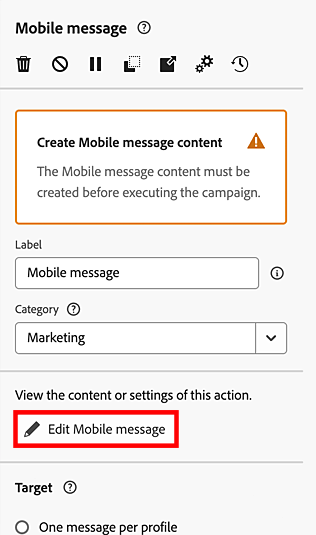

# Filtrar as linhas

## Objetivo

No próximo conjunto de etapas, você filtrará todas as linhas que realmente não têm permissão para serem direcionadas com uma mensagem SMS devido à recusa no nível da linha.  Você não pode confiar aqui no consentimento do Perfil porque este é um público alvo em nível de linha.

## Configurar atividade de divisão

1. Clique no ícone **+** na transição inferior da atividade Fork e selecione a atividade **Split** no pop-up.

   

2. No painel direito, atualize o Rótulo para informar o seguinte: `Filter out opt'd out lines`

   

3. No painel direito, expanda a seção do segmento padrão **Subconjunto** e clique no botão **Criar filtro**

   

4. Adicione uma condição para garantir que você remova todas as Linhas de Clientes que recusaram mensagens SMS e clique em **Confirmar**.

   

   >[!NOTE]
   >
   >Você precisa descobrir como criar a condição, mas o resultado final corresponde à captura de tela acima.  Você conseguiu isso!

5. Clique no botão Salvar no canto superior direito para salvar seu trabalho.  Sua tela se parece agora...

## Adicionar dimensão de alteração

1. Na tela do fluxo de trabalho, clique no ícone **+** após a condição de divisão adicionada e selecione a atividade **Alterar dimensão**

   

2. Atualize as propriedades da dimensão de alteração conforme descrito abaixo e clique em **Confirmar**:
Etiqueta: `Convert Line to Account`
Nova dimensão de destino: `dep-rel: Customer Account`

   

   

## Adicionar a atividade de SMS

1. Clique no ícone **+** após a dimensão Change que você adicionou e selecione a **Atividade de mensagem móvel**

   

   

2. No painel direito, primeiro altere a opção Target para **Uma mensagem por dimensão secundária** e, em seguida, clique no botão **Editar mensagem móvel** para iniciar a configuração da mensagem SMS

   

3. Na navegação superior, clique no item de menu Ações e, no menu suspenso Configuração de mensagem móvel, selecione o canal criado anteriormente.

## Recapitulação

Você filtrou todas as linhas que não podiam ser direcionadas com uma mensagem SMS devido à recusa, alterou a dimensão de linha para conta e adicionou uma atividade SMS para aqueles que podiam ser direcionados.
