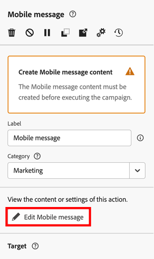

# Filtrar as linhas

## Objetivo

No próximo conjunto de etapas, você filtrará todas as linhas que realmente não têm permissão para serem direcionadas com uma mensagem SMS devido à recusa no nível da linha.  Você não pode confiar aqui no consentimento do Perfil porque este é um público alvo em nível de linha.

## Configurar atividade de divisão

1. Clique no ícone **+** na transição inferior da atividade Fork e selecione a atividade **Split** no pop-up.

   

2. No painel direito, atualize o Rótulo para informar o seguinte: `Filter out opt'd out lines`

   

3. No painel direito, expanda a seção do segmento padrão **Subconjunto** e clique no botão **Criar filtro**

   

4. Adicione uma condição para garantir que você remova todas as Linhas de Clientes que recusaram mensagens SMS e clique em **Confirmar**.

   

   >[!NOTE]
   >
   >Você precisa descobrir como criar a condição, mas o resultado final corresponde à captura de tela acima.  Você conseguiu isso!

5. Clique no botão Salvar no canto superior direito para salvar seu trabalho.  Sua tela se parece agora...

## Adicionar dimensão de alteração

1. Na tela do fluxo de trabalho, clique no ícone **+** após a condição de divisão adicionada e selecione a atividade **Alterar dimensão**

   

2. Atualize as propriedades da dimensão de alteração conforme descrito abaixo e clique em **Confirmar**:
Etiqueta: `Convert Line to Account`
Nova dimensão de destino: `dep-rel: Customer Account`

   

   

## Adicionar a atividade de SMS

1. Clique no ícone **+** após a dimensão Change que você adicionou e selecione a **Atividade de mensagem móvel**

   

   

2. No painel direito, clique no botão **Editar mensagem móvel** para iniciar a configuração da mensagem SMS

   

3. Na navegação superior, clique no item de menu Ações e, no menu suspenso Configuração de mensagem móvel, selecione o canal criado anteriormente.

>[!CAUTION]
>
>Oh, não 🫨!  Por que você não está obtendo nenhum resultado?  Você já não configurou seu canal de SMS?  O produto está quebrado?
>
>ABERRAÇÃO!!!!!!!!

## Momento de surtar

A configuração do canal para SMS já foi definida por você antecipadamente e atualmente parece que sim...

**A forma como você lê isso é a seguinte:**

- Enviar uma mensagem por dimensão de destino (ou seja, Conta de Cliente) no número de registros relacionados encontrados na dimensão secundária (ou seja, Linha de Cliente)
- Execute cada delivery de SMS usando o número do celular encontrado na dimensão secundária (ou seja, Linha do cliente)

Essa capacidade exclusiva de enviar muitas mensagens para um perfil é um dos recursos principais do Orchestrated Campaigns, que o torna diferente do Jornada. No entanto, sua transição para a atividade de Mensagem móvel é definida como Conta do cliente. Isso permite que você o associe de volta ao Perfil de cliente em tempo real no momento do envio, para que as informações de delivery e rastreamento das mensagens sejam atribuídas a um perfil.

Então como você faz isso funcionar? Altere o destino de execução da mensagem para corresponder à configuração do canal 😀

## Alterar o Target e concluir a configuração da mensagem SMS

1. Clique no botão Voltar na tela de edição do SMS

   

2. Com a atividade de mensagem móvel selecionada, no painel direito, primeiro altere a opção Target da opção padrão uma mensagem por perfil para a opção **Uma mensagem por dimensão secundária** e clique novamente em **Editar mensagem móvel**

   

3. Na navegação superior, clique no item de menu **Ações** e, no menu suspenso Configuração de mensagem móvel, selecione o canal criado anteriormente.

   

## Recapitulação

Você filtrou todas as linhas que não podiam ser direcionadas com uma mensagem SMS devido à recusa, alterou a dimensão de linha para conta e, no final, configurou com êxito a atividade de SMS para aqueles que tinham permissão para ser direcionados.
Esperamos que você também tenha aprendido algo muito importante - **seu público-alvo deve corresponder à configuração de canal que você deseja usar**
